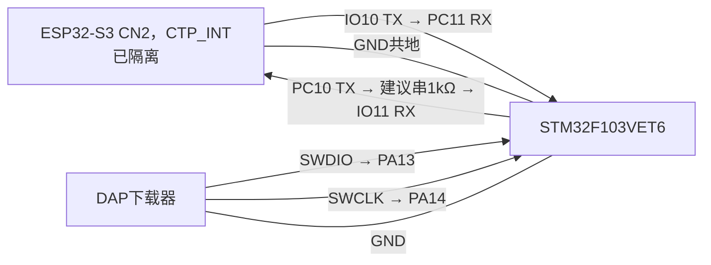
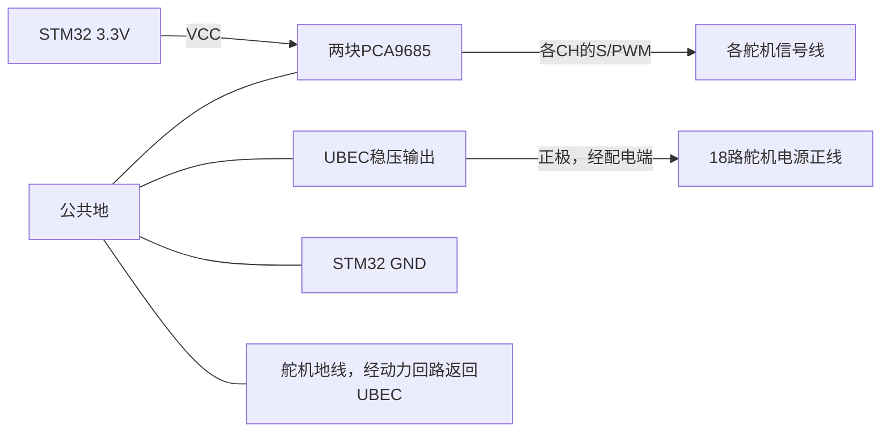

# 双板系统全部外设接线说明

> 本文正文已同步至 CN2 IO10/IO11 新版，编译与下载见
> [IO10/IO11接线与编译下载](IO10_IO11接线与编译下载.md)。
> IO10用作发送前必须物理隔离屏幕CTP_INT；IO11接线后不可按USER。

更新时间：2026-11-04。适用：GEC ESP32-S3 V1.0.1（GC0308）＋STM32F103VET6 Guide_MQTT，ESP32变体 gec-esp32-s3-lcd35-camera-stm32-cn2。

本文根据当前源码和已核对的 GEC 原理图整理。GPIO 是芯片信号名，不是连接器从左到右的针号。STM32 底板与外接模块的排针方向，以实物丝印/原理图为准；未确认的物理针序不作猜测。接线说明不等同于已经完成实物验证。

## 1. 供电总原则：控制板、下载器、舵机分清楚

| 部件 | 供电方式 | 说明 |
|---|---|---|
| ESP32-S3 主板 | 板上规定的 USB/电源入口 | 按板卡要求供电 |
| STM32 底板 | 底板规定的 USB/电源入口，并打开电源开关 | DAP 被电脑识别，不代表底板已得到供电 |
| 两块 PCA9685 的 VCC | STM32 的 3.3V 逻辑电源 | 给芯片及I2C上拉供电，不能接舵机6V |
| 18路舵机 | 独立 UBEC 稳压输出，经合适的配电线分支 | 输出电压按实际舵机规格设置；先测量后接入 |
| 普通5V版 HC-SR04 | 稳定的5V电源 | 不接6V舵机电源；3.3V版本按模块规格处理 |
| ESP8266裸模块 | 稳定的3.3V电源 | 若是底板原配插接模块，使用原配供电接口 |

所有信号相关地线共地：STM32 GND、ESP32 GND、两块 PCA9685 GND、HC-SR04 GND、ESP8266 GND、UBEC 输出负极。舵机的大电流回路线直接回 UBEC/配电端，不经过细小的开发板地线。

两块开发板分别供电时，双板通信只接 TX、RX、GND，不互连两板的3.3V/5V电源输出。UBEC若设为6V，只给符合此电压规格的舵机供电，不送入STM32/ESP32的3.3V、PCA9685 VCC或HC-SR04 VCC。

改线前断电。首次通信/下载测试可先断开舵机动力电源，只给控制板供电。

## 2. 双板 UART 通信：三根线

| ESP32-S3 | 方向 | STM32 |
|---|---|---|
| CN2 IO10 / UART1 TX | → | PC11 / UART4 RX |
| CN2 IO11 / UART1 RX | ← | PC10 / UART4 TX，建议串联1kΩ |
| GND | 共地 | GND |

串口参数：115200 baud，8数据位，1停止位，无校验、无硬件流控，3.3V逻辑。

### 照片中上排 CN2 焊盘的位置

按用户提供的板背面照片方向，上排五个焊点从上到下为：

| 顺序 | 丝印 | 本次连接 |
|---|---|---|
| 第1个 | VBUS | 不跨接两板电源 |
| 第2个 | 3.3V | 不跨接两板电源 |
| 第3个 | GND | STM32 GND |
| 第4个，圆焊点 | IO10 | STM32 PC11 |
| 第5个，方焊点 | IO11 | STM32 PC10，建议串1kΩ |

下排I2C-SDA/I2C-SCL对应GPIO1/2，共用于音频、PCA9557、触摸，不能直接作为本版UART接线。

**硬件条件：**IO10与屏幕接口U12第13脚CTP_INT直连，上电前必须在屏幕转接线处物理隔离这一根信号，保留其他屏幕线路。仅关闭触摸软件不能断开触摸芯片的输出。

IO11还接USER按键SW3。新版不创建USER的GPIO驱动，但实体按键仍会把IO11接地，接线后不要按USER。建议PC10到IO11串1kΩ限制误按电流；这是保护电阻，不是通信必需或电平转换元件。没有电阻时可临时直连，但须避免误按；电阻不能替代CTP_INT隔离。

本版不用TF转接器，拆除旧GPIO47/48通信线。未实现SD卡功能，不应因释放TF引脚就插卡。STM32 PC10/PC11用于UART4，不能同时启用占用它们的SDIO/TF功能。

只有显式选择旧变体gec-esp32-s3-lcd35-camera-stm32，才使用GPIO47 TX/GPIO48 RX；旧固件不能套用本节IO10/IO11接线。



## 3. 两块 PCA9685 到 STM32

### 第一块：I2C1，负责全局舵机ID 0～8

| PCA9685 第1块 | STM32/连接位置 |
|---|---|
| VCC | 3.3V |
| GND | GND公共地 |
| SCL | PB6 / I2C1_SCL |
| SDA | PB7 / I2C1_SDA |
| OE（若引出） | 保持低电平使能；检查模块自带下拉，必要时接GND |
| A0～A5 | 保持全0地址配置，常见模块默认不焊地址桥 |
| V+ | 按下节的舵机供电方案处理，不能当作VCC |

### 第二块：I2C2，负责全局舵机ID 9～17

| PCA9685 第2块 | STM32/连接位置 |
|---|---|
| VCC | 3.3V |
| GND | GND公共地 |
| SCL | PB10 / I2C2_SCL |
| SDA | PB11 / I2C2_SDA |
| OE（若引出） | 保持低电平使能；检查模块自带下拉，必要时接GND |
| A0～A5 | 保持全0地址配置 |
| V+ | 按下节的舵机供电方案处理 |

两块都使用**7位地址0x40**，因为它们分别位于不同总线。不要在未修改代码的情况下把两块SDA/SCL并到同一总线，也不要自行把第二块改成0x41。当前程序没有接管OE控制引脚。

确认模块I2C上拉接到3.3V；如模块无上拉，应按总线电容和速率配置外部上拉。OE低电平有效的定义见 [NXP PCA9685数据手册](https://www.nxp.com/docs/en/data-sheet/PCA9685.pdf)。

### 舵机ID与实际通道：不是连续CH0～CH8

| 软件舵机ID | 所属PCA9685 | 舵机信号接脚 |
|---|---|---|
| 0 | 第1块 | CH0 |
| 1 | 第1块 | CH1 |
| 2 | 第1块 | CH2 |
| 3 | 第1块 | CH4 |
| 4 | 第1块 | CH5 |
| 5 | 第1块 | CH6 |
| 6 | 第1块 | CH8 |
| 7 | 第1块 | CH9 |
| 8 | 第1块 | CH10 |
| 9 | 第2块 | CH0 |
| 10 | 第2块 | CH1 |
| 11 | 第2块 | CH2 |
| 12 | 第2块 | CH4 |
| 13 | 第2块 | CH5 |
| 14 | 第2块 | CH6 |
| 15 | 第2块 | CH8 |
| 16 | 第2块 | CH9 |
| 17 | 第2块 | CH10 |

每块使用 `{0,1,2,4,5,6,8,9,10}`；CH3、CH7等空出的通道不要误接。语音“0号舵机”对应第1块CH0；“9号舵机”对应第2块CH0。

这些是软件编号，不代表已确认机器人左前腿/右后腿等实际位置。步态使用前仍要按现有 `hexapod_config.h` 和实物逐一核对关节方向、零位与安装位置，不凭本表修改步态配置。

## 4. 舵机与 UBEC：优先按独立配电方式连接

### 方案A：UBEC直接给舵机供电

适用于已经将18路舵机动力线接到独立配电端的接法。

| 舵机线 | 接到哪里 |
|---|---|
| 信号线（常见橙/黄/白） | 对应PCA9685通道的S/PWM端 |
| 电源正线（常见红） | UBEC输出正极，经配电端分支 |
| 地线（常见棕/黑） | UBEC输出负极/配电地，与PCA9685、STM32共地 |

线色只是常见情况，必须以实际舵机标记为准。PCA9685的VCC仍接3.3V，GND仍接公共地。在这种独立配电方案下，**PCA9685的V+可以不接**；舵机红线已从UBEC得到电源。不要让舵机大电流经过STM32的3.3V/5V排针。



### 方案B：舵机三线插PCA9685排针

仅当你确实采用这种配电方案时，才将符合舵机额定电压的电源接到模块V+，并按S/V+/GND接好三线。此时V+不接电，舵机就不会动作。18路大扭矩舵机的总电流可能超过模块端子、铜箔和线材能力，不能未经核对就全部通过一块模块供电。

方案A和B必须按实际接法选择；不要将独立UBEC输出与另一个电源的输出并联。UBEC输入接符合其输入范围的电源/电池，IN与OUT不能接反。

## 5. HC-SR04 超声波

当前工程引脚固定为 **Trig=PA2，Echo=PB12**。

| HC-SR04 | 连接 |
|---|---|
| VCC | 普通5V版接稳定5V；若为3.3V版按该版本规格 |
| GND | STM32 GND |
| Trig | STM32 PA2 |
| Echo | 经合适的电平处理后接STM32 PB12 |

普通HC-SR04和3.3V兼容版本并存，不能仅凭外形认定电平。参考 [5V版说明](https://www.sparkfun.com/ultrasonic-distance-sensor-hc-sr04.html) 与 [3.3V兼容版说明](https://www.sparkfun.com/ultrasonic-distance-sensor-3-3v-hc-sr04.html)。

对5V Echo、且底板接口没有自带电平处理的情况，可以使用以下分压，将5V降至约3.0V：

```text
HC-SR04 Echo ── 2.2kΩ ──┬── STM32 PB12
                        │
                       3.3kΩ
                        │
                       GND
```

这是2.2kΩ串接Echo、3.3kΩ从PB12节点接地，不要接反。若已通过底板自带电平处理接口连接，不要再重复分压；若模块本身输出3.3V，也不要套用此分压。PA2的3.3V触发信号应与具体模块输入规格相容，若模块要求更高触发电平则需匹配电平转换。

## 6. ESP8266 模块：保留原手机MQTT通道

该模块连接在STM32上，与语音用的ESP32-S3是两块不同的模块。

| ESP8266 | STM32 |
|---|---|
| RXD | PD8 / USART3 TX |
| TXD | PD9 / USART3 RX |
| EN / CH_PD | PB8 |
| RST | PB9 |
| GND | GND |
| 电源 | 原配底板供电接口；裸模块使用足够电流能力的稳定3.3V |

这里USART3使用重映射后的PD8/PD9，**不是PB10/PB11**；PB10/PB11已给第2块PCA9685使用。已有原配插座接好时，不再额外跨接同名信号。裸ESP8266的启动绑定位和稳压电路依实际模块资料处理，不能直接给裸模块VCC接5V。

## 7. DAP 下载与串口日志

### DAP → STM32：用于下载程序

| DAP端 | STM32端 |
|---|---|
| SWDIO | PA13 / SWDIO |
| SWCLK | PA14 / SWCLK |
| GND | GND |
| nRESET / RST（可选，复位连接需要时使用） | NRST / RESET |
| VTref（若有独立参考电压输入） | 按下载器手册接目标板3.3V参考 |

DAP接口若标“3.3V”，须先确认这是供电输出还是参考电压输入，不能凭名称把两个电源输出相连。**仅接DAP线，不代表STM32底板已经供电。** 底板应从正常电源入口供电并打开开关。

Keil：Options for Target → Debug → CMSIS-DAP Debugger → Settings；Port=SW，初次排障可用100kHz。左侧显示CMSIS-DAP HID只说明电脑识别下载器；右侧识别到目标芯片后再下载。SWD通信失败时先检查底板供电、共地、SWDIO/SWCLK及线序，不要把PC10/PC11当作下载接口。

### USB-TTL → STM32：可选，用于查看日志

| 3.3V逻辑USB-TTL | STM32 |
|---|---|
| RXD | PA9 / USART1 TX |
| TXD（需要输入控制命令时） | PA10 / USART1 RX |
| GND | GND |

串口参数按当前USART1配置（本工程115200/8N1）。板上已带USB转串口时优先用原接口，不要让两个TX同时接到PA10。DAP、USB-TTL日志接口、UART4双板通信是三种不同用途。

## 8. 板载 RGB 灯与蜂鸣器

| 功能 | STM32引脚 | 软件有效电平 |
|---|---|---|
| 红灯 | PB5 | 低电平亮 |
| 绿灯 | PB0 | 低电平亮 |
| 蓝灯 | PB1 | 低电平亮 |
| 蜂鸣器控制 | PA8 | 高电平使能现有板载电路 |

使用指南者底板原有RGB灯、蜂鸣器时按板上电路/跳线启用，一般不需要另外拉杜邦线。上表是现有驱动信号，不表示可以把外部大电流灯或蜂鸣器直接接GPIO；外接负载需要匹配的驱动电路。

## 9. ESP32摄像头、屏幕、触摸与音频

GC0308使用J6相机接口；显示、音频沿用原配连接。CN2版必须单独隔离屏幕CTP_INT与IO10的连接，其他屏幕线路保留；触摸采集已关闭。排线插拔先断电，按原理图确认接口编号与触点面，不凭照片猜排线针序。

以下仅为当前代码的信号核对表，**不是连接器物理针序**：

| 外设 | 软件信号对应 |
|---|---|
| GC0308 D0～D7 | GPIO16、18、8、17、15、6、4、9 |
| GC0308 XCLK / PCLK | GPIO5 / GPIO7 |
| GC0308 VSYNC / HREF | GPIO3 / GPIO46 |
| 相机SCCB及音频/触摸共用I2C | GPIO1 SDA、GPIO2 SCL |
| 屏幕 MOSI / SCK / DC / 背光 | GPIO40 / GPIO41 / GPIO39 / GPIO42 |
| 屏幕片选、相机PWDN、音频功放使能 | 由板载PCA9557扩展器控制，使用原板连接 |
| 音频 MCLK / BCLK / WS | GPIO38 / GPIO14 / GPIO13 |
| 音频 DIN / DOUT | GPIO12 / GPIO45 |
| USER按键 | 硬件仍接GPIO11，CN2版软件禁用，通信时不可按 |
| BOOT按键 | GPIO0；单击对话、双击相机页、运行时长按3秒配网 |
| CN2双板UART1 TX / RX | GPIO10 / GPIO11 |

GPIO10在本版用于UART TX，必须先隔离原CTP_INT。屏幕点击、滑动、触摸拍照/重拍与USER操作不可用；显示、语音、摄像头和BOOT操作保留。IO10对应LED6可能随UART发送闪烁，不能独立控制。

板载PCA9557是IO扩展器，**不是外接舵机用的PCA9685**。扬声器、麦克风接原配音频接口，不将功放负输出端当作GND。

## 10. 接线完成后的检查顺序

1. 全部断电检查正负极、接头方向；确认两块PCA9685的VCC为3.3V，舵机动力没有送入逻辑电源。
2. 确认CTP_INT已物理隔离、USER未被压住；暂不接舵机动力，给两块控制板分别供电。
3. ESP32使用CN2固件；STM32使用本目录配套固件。已运行兼容版STM32时不因ESP32换引脚重复下载；旧STM32固件才需用DAP更新。
4. 让小智查询STM32连接状态和超声波距离；必须收到真实回包，口头说“完成”不等于通信成功。
5. 测试“打开STM32红灯”“蜂鸣器响200毫秒”“关闭灯”。
6. 给单路舵机供电，在架空、可随时断电条件下，用原舵机命令小幅点动，逐一确认ID和通道。
7. 步态必须按原校准文档完成机械参数、方向、零位核对；接线完成不代表可直接落地走动。本文不修改步态配置。

| 现象 | 优先检查 |
|---|---|
| DAP识别了但SWD/JTAG Communication Failure | 底板供电、SWDIO/PA13、SWCLK/PA14、GND、下载器设置 |
| ESP32显示离线/串口超时 | 两板供电、IO10→PC11、PC10→IO11、共地、CN2变体、CTP_INT隔离与USER状态 |
| 连续OK pong | 双板UART双向收发已有证据，不等于外设动作已验证 |
| OK echo_high | 回包成功，但PB12在触发测距前为高，无有效距离；先确认传感器已连接 |
| 灯光指令unknown command | STM32是否也更新到支持rgb/beep的新固件 |
| PCA9685无应答 | VCC、SDA/SCL、总线区分、0x40地址、上拉与共地 |
| 舵机不动但I2C返回成功 | UBEC动力、S脚通道、OE、舵机本体与机械状态 |
| 只有部分舵机不动 | 是否误接CH3/CH7、两块板顺序、软件ID映射 |
| 超声波无回波或超时 | PA2/Trig、PB12/Echo、5V供电、分压或转换、目标位置 |
| 动舵机时两板重启 | 动力电源能力、回流路径、压降、接线与共地方式 |

## 11. 本文核对依据

2026-11-04用户最新日志出现连续OK pong，说明串口往返已通；用户明确超声波尚未接上，因此测距尚未验证，echo_high不能据此判定模块损坏。舵机动作、步态和CTP_INT物理隔离情况仍需现场确认。

- STM32：`Core/Src/i2c.c`、`usart.c`、`app_servo.c`、`servo_io.c`、`board_io.c`、`Core/Inc/main.h`、`Guide_MQTT.ioc`。
- ESP32：`main/boards/gec-esp32-s3/config.h`、`gec_stm32_link.cc`，以及GEC V1.0.1原理图J3/CN2接口。
- 软件引脚、I2C地址和18路通道已核对；外接模块的具体版本、实际针序、电源容量及现场接线仍需按实物确认。
